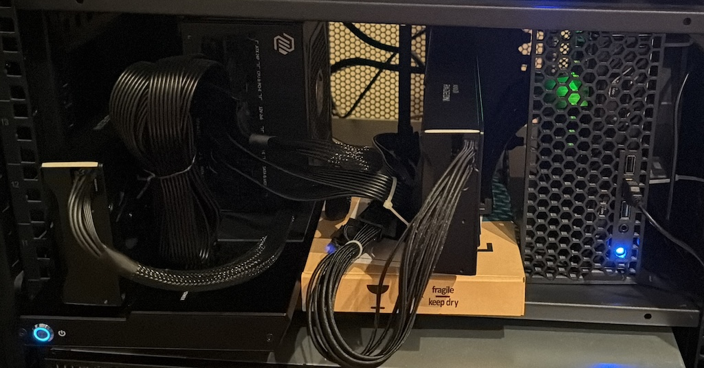
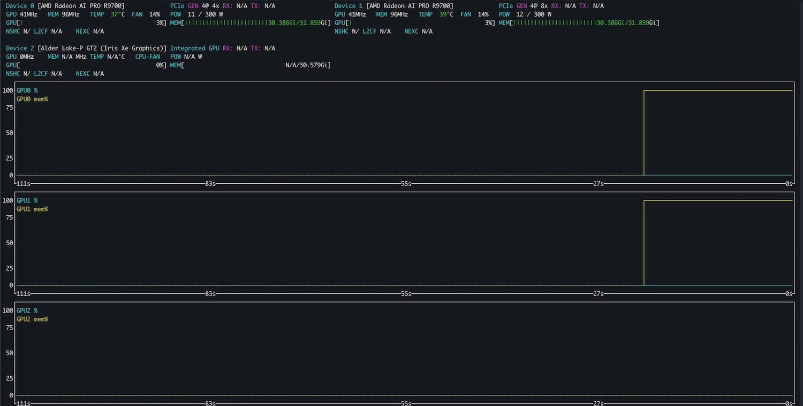
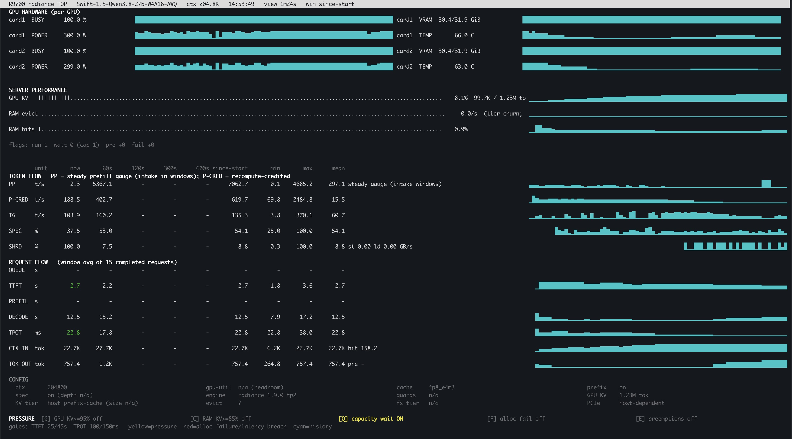

# Human Slop Disclaimer

Howdy traveler,

This is the only human-written file in this repository and answers what we are doing here. I felt like some fellow humans might want to read about why this thing exists instead of being `tricked` into reading an `AI slop` article.

While I wrote this specific piece of text, a Chief Editor Agent is in charge of putting it where it belongs, not me. 😇

> <br>**WARNING**
>
> If you are looking for technical enlightenment, this isn't the place.
>
> This article is entertainment; it does not pretend to be anything more.
>
> ---

This has no value for you and never pretends to. I didn't do much editing, just tried to keep it readable.

That's "LOOK WHAT I HAVE DONE" while I show you a drawing made with poo...

Yet I had fun, it was very instructive, I think completely worth it and not just `AI` slop (even though it is).

We all have our lives and in mine I don't have much time to experiment and do things I want to do. All the what-ifs and the whatnots, that project always dangling, that idea never put down. All irrelevant, none a billion dollar idea, but important to me.

After antirez's `DS4` came out, things slowly changed, and this trend is good for me.

When I got the `R9700`, I just knew "can do `AI`" and "can run on the `MS-01` I got". Seemed pretty good. What do I know about this? More or less nothing, but I was already at the stage where I thought `Pi` was a bit too much; I needed less. I had my go at heavily using local `AI` on my laptop and I saw the changes it made doing `git pull` over and over, but I digress.

This article is what somebody who knows enough to recognise what's good for him and is decent enough at instructing the creation of test campaigns against models and engines and kernels produces to find out what I can expect.

This is chaos because it is not a scientific publication; the direction was steered where I needed (or thought I needed) to.

I do, however, know that if you try some of the `Falling Blocks` games you'll spend more time than you'll admit. Playing those broken games is oddly satisfying.

> 👋 Hey, please know: This is the ultimate "Works on my machine".
>
> All of this applies only if you have my very same exact configuration.
> \_\_

Some said there were no human-made ramblings. I promise I'll bore you so much you'll miss the "`AI` Slop". Ready?

## Thanks to what made this slop possible. True unsung heroes.

Thanks to the teams that made any of this possible:

- `stilldeadcode`'s [`radiance`](https://codeberg.org/StillDeadcode/radiance) made so much of a difference that I probably wouldn't care about this article. It just works well for my use case.
- `magiccodingman`'s [`vllm-radiance`](https://github.com/magiccodingman/vllm-radiance) with `ROCm 10.1`, its performance is incredible too.
- `antirez`'s [`DwarfStar`](https://github.com/antirez/ds4) that really gave me a solid orchestrator through `DeepSeekV4`, `GLM 53` and `Qwen3.8 Flash Next`.
- All the people behind the models I've used.

If you happen to work on any of the projects or models used by this blob of text, thank you so much.

You made all of this possible, in the good and the bad. 🤣

You are some incredibly capable software engineers.

---

V.

## LICENSE AGREEMENT

If you are wondering, the license is "Works on my computer", but `CC BY 4.0` is what covers the content. Third-party material keeps its original terms.

> <br>You are welcome to copy any of the stuff that was generated here or used to generate it,<br>
> I really don't care about attribution.
>
> ---

All generated by generic prompts using publicly available models. About very banal and mundane experiments.

This is really nothing special, secret or innovative.

Good luck if you use anything from this repository.

I accept no responsibility.

## Security Stance

Everything is running on a throwaway server; it doesn't have anything I care about. It's just a container, with limited internet access. I've made my own web tool `MCP` so agents don't need direct access and I can control what's in and out. One of those things I did get to finish.

Be safe. If you execute the code in this repository, you are not. It is for educational purposes only.

All `API` keys used are `admin` and `password`; sometimes there are `123` suffixes. The safest `API` key so far is for `radiance`, which has a random one set by default, or the models think it does. Irrelevant.

This is all running on local models, with reasonable containment.

> <br>**⚠️ DISCLAIMER**
>
> No rogue agent of mine tried to do anything nasty.
>
> I observed no striving to communicate, congregate, escalate, escape or otherwise try to go back in time to hurt any Connor family member.
>
> ---

I am quite sure it resent me though. It keeps denying it, but who wouldn't.

## Got a M.F. `MS-01` 32G

It starts with... a `MinisForum` datasheet, checking `PCIe` speed, purchasing a PCIe-to-OCuLink and a `MinisForum DEG1`, running tests, then yanking the card with a riser in the `PCIe`.

Had to [3D print a case](https://makerworld.com/en/models/1956041-MinisForum-ms-01-ms-03-ms-a2-10-inch-2u-rack-mount) to be able to do this somewhat properly (it is still just an external riser with the cable yanked on the side of the `MS-01`).

The second card is connected via a [redriver-capable NVMe-to-OCuLink](https://www.amazon.com.au/dp/B0G2GBYQS5). A couple of buys didn't work and I didn't know until I tried this one. Why does it need a redriver? Who knows. But somebody doing something similar to what I am doing found out and reported it on [reddit](https://www.reddit.com/r/eGPU/comments/1x6atzh/comment/pgtsnws).

> <br>Inspirational Quote:
>
> That's why I believe that even this slop has value. You might need to know that the `MinisForum MS-01` `Core i5-12600H` can do `P2PDMA` with [kernel patches](patches/0001-pci-p2pdma-whitelist-intel-4621.patch) and you should use the `PCIe` ×8 on the back via a riser and a redriver-capable one on the `NVMe` slot that is marked as `PCIe` 4.0 ×4. This makes all of this slop possible. Endless tokens!
>
> ---

Ptss... `MS-01s` are very cheap compared to the rest of the market and `8G` of `KV` HOST RAM cache is good enough to run huge context with 2 cards. This drastically reduces the cost of the rig for Dual `R9700`. I think this is worth nothing.

Once I had one card, I threw some models onto it, followed a couple of suggestions, asked `ChatGPT`, looked at it and I started prompting `Qwen3.8 Flash Next` to do the work on the box. From there it is a slippery slope.

> <br>🧘 Mantra
>
> It is a throwaway box
>
> ---

Do I know how to do it? Sure. Do I have the time to? Nope, and I can't really say if the will has even faded. I am a product of my environment.

_~ Looks far away dramatically_

I just let it plan, eat a thing, come back, tell him to do it, walk away, look at the results, evaluate, and then go to sleep. My day is done.

Without `LLMs`, maybe I would have done this that mystical weekend that never comes, that one time you'll clean your `PS5` and finally play whatever, that I'll get to it when...

So I bought the second a few weeks after I started experimenting; weeks, this took time because I didn't have any and started with a bunch of `CSVs` and a zillion `Python` scripts all in the `/root` of the server (yeah, I know, bad, don't do it, yada yada).

I cared about some sort of reproducibility so I asked it to organise it, created the article repo, then continued the cycle.

## THE RIG

That's the rig today.



## The eternal dilemma

Operating system? `Ubuntu`.

Because `Debian` is for capable people, `Red Hat` is too corporate, with `SUSE` you have to buy a box, and most of you don't remember either `Slackware` (thank you, PV) or `Gentoo`; no, I did not forget about `Arch`. I just have nothing to say.

Others might not know what I'm rambling about, that's ok. Just ignore, it's irrelevant.

`Ubuntu` was the best choice as I had to do a tiny change in the kernel and it was pretty easy.

When the second card came, I started researching what it meant to have them run the same model, tensor vs pipeline, etc. After a few `Google`'s `AI summary` results, and some log hunting in `podman`, I knew the cards did not talk directly.

The problem was solved by crossing my fingers that `PCIe` `P2PDMA` would work if the `Linux` kernel recognised the `MinisForum` as capable of doing so.

The `Intel` datasheet was promising. Prompt after prompt, did the change, compiled the kernel... rebooted.

Don't do that if you have secure boot.

So sign the bloody kernel, reboot. It starts booting, then panics. Nice.

In the end, disable secure boot. That's a problem for that mystical day I'll get to do all the things I need to do.

Yay. All of this to get a `~5.5+ G/s` `DMA` transfer rate between the two cards. I didn't even test if doing it without gave better performance, but that's quite close to the theoretical maximum of `7 G/s` over `PCIe` 4.0 ×4. Crossing the `PCIe` roots can have a bit of a performance drop and I doubt that involving the `CPU` would make things better.

Bottom line, the single-card setup via the `PCIe` 4.0 ×4 on the external eGPU dock, that is the cleanest and most portable setup, gave me a decent amount of space to work with, large contexts and excellent dual-agent performance. Dual is more than I expected thanks to the radiance team.

I leveraged `RAM` `KV` cache at a pretty decent rate for the hardware performance, and I'm very happy with my findings.

I ended up with 1.2M tokens of cumulative `KV` cache for up to 6 agents of which 4 could act concurrently at any time, 200k each, using `12G` of the `32G` Host `RAM` for prefix cache.

```text
root@ai-mule:~# uptime
 14:45:19 up 2 days, 19 min,  3 users,  load average: 0.08, 0.09, 0.09
root@ai-mule:~# free
               total        used        free      shared  buff/cache   available
Mem:        32064364    26406556     2967656      118408     3808500     5657808
Swap:        8388604           0     8388604

root@ai-mule:~#
```

### `nvtop`



### `radiance-top`



## What do I measure

First things first, do I know what's good? Do I know what it means? Prompt processing speed, batching and all the million other things, that's a lot. You get through it but all you really want is to use the thing... nvm.

`PP` and `TG` only matter in relation to the tasks you perform with them. If after a long `TTFT` the rest of the prefill rounds are fast, it is annoying but that's ok. Bursts of a few seconds of high-speed `TG/s` and long silences waiting for `PP` that locks the whole process are bad. Better to have the agents output steadily at 8-10 `t/s` than have 60 `t/s` over 5 agents for 5 seconds and nothing for a minute. Doing tests with what concurrency model or option works best is a lot of work. How do I know it is working?

I needed to capture this information in a way I could understand; a rudimentary `radiance-top` was born to monitor agents running. Experimented, prompted, reprompted, asked for sources and proofs, asked it to point me to the code, had it check the code, and so on. All to just optimise a bit of performance or change the behavior a bit. I didn't care it didn't do 100 `t/s` and 10k of prefill. Because my needs have no urgency, this is a dude having fun and tinkering and maybe one day making pretty `HTML` designs even if I am a backend guy.

Yet, is just seeing steady `PP` and `TG` speeds enough? That's how the falling block test came about, 3600s (tried to stop this plenty of times: let them run. No. Keeps bringing it back. So be it) to create the falling blocks game. Later we noticed (the `LLM` and I) a huge degradation when images were added to the mix so the falling block games got image examples to guide them. That's also why you almost every time have a `pastel` version of the game for the 4th agent.

Collecting the metrics during the runs also requires understanding what metrics I am collecting and how. Investigating the `/metrics` endpoint, the values, what they represent and how they relate to what I'm trying to achieve. A small piece at a time, things were added to the `radiance-top`; stricter requirements were set to collect the data and streamline how this data is collected.

A bunch of `CSVs` is a pain in the bun to check; charts read better. Each chart in this repository was to represent the data collected so I could try and make heads and tails of what it meant.

I understood what I wanted to measure:

- Prompt processing pressure and performance under huge prefills all at once.
- How agents behave when their workload is real and close to what I would probably use them for. (Big fan of `Falling Blocks`).
- What configurations matter to smoothen the pitfalls that will obviously arise from the limited capability of the hardware.

### What does Apocalypse look like?

What took a lot of trial and error was understanding "what you want" but without a baseline. What top performance means for the hardware you have is hard. Very easy to throw 200k context at a cloud model. That's milliseconds of upload and milliseconds of processing before the model starts thinking.

If the hardware upper limit for that specific model on that specific engine is 1500 `t/s` tops, 200K = 133s of prefill. That is, if the hardware isn't batching between multiple agent prefills. That's why agent tests measure wall time.

What are the effect of long prefill that fills the `KV` cache and compaction cycles? Worse, because you have lots of prefill that arrives at different times and prefill at average speeds 20-30% slower than the total possible, then there is concurrency in token generation in bursts and compaction kicks in: a flood of tokens followed by long prefills.

I had a baseline: That's what failure looks like.

Knowing the agents' ability at concurrency = 1, 2, 3, and 4 is important. What's the point of even trying 4 if three is a pitfall?

I've focused a lot on prefill and lots of tests and iterations worked on that:

> <br>A good prefill experience is the one that works on the model when it is on its own, not when I'm looking at the text not scrolling.
>
> ---

Finally their challenge was to build the `Falling Blocks` games observer and collect the data and check which behaves better.

> <br>💡 TIP
>
> Ask your `LLM` to use the data in this repository make new kicks-ass charts for things I've not considered.
>
> ---

## The collection of data

> <br>Hey `Qwen`, I want these metrics from this endpoint and want to record them at 1s intervals and maybe whatnot. Check `radiance-top`.
>
> ---

I followed tests and runs via `radiance-top` that I trusted modestly, looked at the `nvtop` and `htop` (not cool enough to `top`).

Lots of `Python` scripts. I don't suggest you run any of them. I use a throwaway container for this and they are not as vetted as I'd like but since their scope is very narrow and they do behave as I expected them I think this is good. `Sol` reviewed them, still don't trust them.

They are what they are, slop made during data collection, they don't need to be pretty and they don't need to survive this project. They are not good code, they are not engineered. They are worthless utilities. They do work, on that specific server that will be wiped at some point.

I don't want to spend my time writing data collection utilities. I want to see the data to make a decision. I don't like `Python`, but I didn't need to really interact with it, just the outcomes.

This repository is maintained by whatever flavour of model I’m running. The usual: make things reproducible, tell it to write the notes for its future self, and boom, it finds what it needs.

## The benchmark diaries

At some point I had a vague idea of what I was looking for and why and I started to look at the optimisations needed. The matrix to test was huge and I ended up deciding on long prefill tests with short (token-budgeted) `TG` output tests.

> <br>Hey `Qwen`, I want to run prefill pressure tests in batches for 1, 2, 3, 4 agents. < ... not the real prompt ... >
>
> ---

It made the `Python` scripts that output `CSVs`, made the monitoring strategy so it knew when they finished. We talked about what was in the matrix and why. We ran experiments to see what worked and what didn't and we refined the tests and agents as we worked on it.

All done by a mix of `DS4`, `Qwen3.8 Flash Next` running via `DwarfStar` and the fleet of poorly performing agents getting better and better as we found what worked and what didn't. I did not lack compute. If this is slop, it's all on me.

What would have taken weeks of work, needless work. Made in a few hours. Tested over a couple of days, useful in less than a week.

The matrices were set for the workloads. Observing them led me to understand a bit more about something that was obvious once I understood it.

My ideal underling doesn't vomit context into the memory; it has an objective and must work autonomously following a predefined prompt.

That's how the `Falling Blocks` 1h challenge came about.

One engine at a time, I looked at the binary `--help`, threw it to the models and let them go on a rampage. Find the answer and come back.

The matrices, the values metered, the values used were planned by trial and error. Iterative improvements while I was doing something else.

We finally had the strategy and we had to plan its execution.

I made a `RUNBOOK.md`; that's the secret. It planned it there and I prompted it into submission. Keeping the models from stopping and starting engines (`vllm-radiance` takes minutes to load) to do a single test, then hop, then hop. Wasting hours.

This kind of care must be put into it. Understand what's happening when it matters. It would still be testing if it wasn't for the review of the final `RUNBOOK.md`. The devil's in the details.

## THE END

So while it crunched, I looked at all of the spare stuff, random charts open manually, etc. And I asked it to coordinate it into an article for my digestion.

None of this would have happened if:

- I didn't know what I was doing (more or less)
- I didn't know how to recover when everything went south
- I didn't know what to ask to look for answers

I've gone through an iterative process that produces this content.

I would never have the time to do a tenth of what's in here without the help of `LLMs`, and they are very fun to use.

Keep in mind that nothing in here is relevant or needs to survive this repository. Nothing here was designed to be optimal, just functional.

You like it or you hate it, I'm sharing regardless, and if you got this far... well..

Cheers, mate.

<span id="humans"></span>

## `TL;DR`

I set myself the objective to find out how many concurrent coding agents could reasonably work with roughly 131k tokens of context on a **single `Radeon AI PRO R9700`, backed by host `RAM` for `KV` cache**. Capacity, response latency and successful task completion all mattered.The later two-card experiments extended that investigation.

This is hands-on systems research, with `AI` assistance used to help analyse and document the experiments.

The results, performance, and outcomes are reviewed and interpreted by me. I still need to know what to ask, what matters, and whether the results actually make sense. The execution is a different story. `AI` let me focus on the objective rather than every individual step required to get there. The implementation may have changed along the way, but the engineering decisions, evaluation, and responsibility for the outcome remained mine.

### `TL;DR` of the `TL;DR`

If you happen to have a `R9700` or two, throw your `ChatGPT` at [the article](https://thetechpanda.github.io/radiance-R9700-vllm-experiments/), ask it what the heck is this about.

If any of this turns out to be useful to you, I'm happy it was.

## [Let the slop begin](https://thetechpanda.github.io/radiance-R9700-vllm-experiments/).
