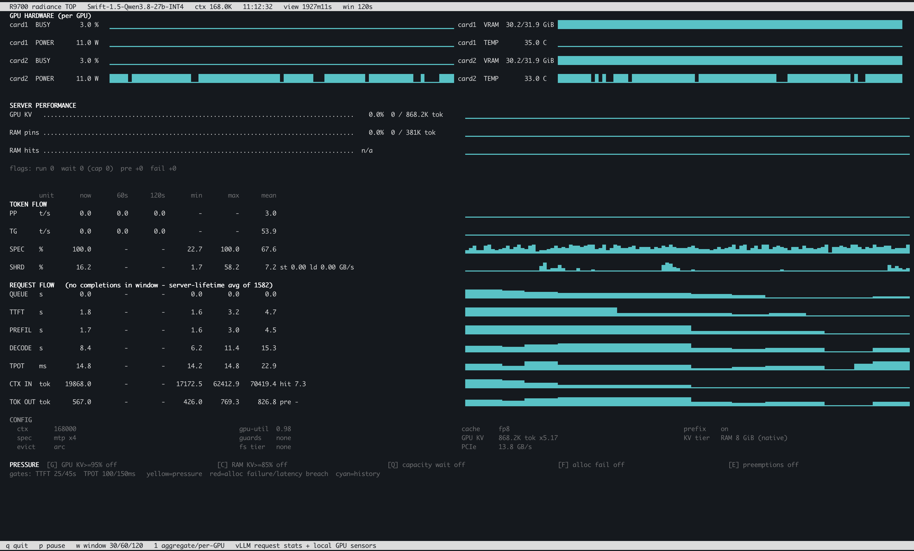

# ROCm 7.14 vs ROCm 10.1 with vllm-radiance on R9700

## Humans

The original objective was to find out how many concurrent coding agents could each work at roughly 131k tokens of context on a **single Radeon AI PRO R9700, backed by host RAM for KV cache**. Capacity, response latency and successful task completion all mattered. The later two-card experiments extended that investigation.

This is hands-on systems research, with AI assistance used to help analyse and document the experiments. It started as an attempt to squeeze as much useful Qwen3.8 27B inference as possible out of a Radeon AI PRO R9700, and eventually grew into a two-GPU investigation.

The results, performance, and outcomes are reviewed and interpreted by me. I still need to know what to ask, what matters, and whether the results actually make sense. The execution is a different story. AI let me focus on the objective rather than every individual step required to get there. The implementation may have changed along the way, but the engineering decisions, evaluation, and responsibility for the outcome remained mine.

I did this because it was fun, and I had a blast doing it. That's really the only reason this repository exists.

Don't expect anything more from it. There is a ton I don't know, and nothing here should be treated as "100% correct." This is simply a blob of information documenting what I did, what I observed, and what I think matters. It doesn't pretend to be anything more than useful context you can throw at your agents while configuring and benchmarking your own R9700.

Comments are welcome, but that doesn't mean they'll be listened to. I have no plans to maintain this repository any further. I did what I did, I published what I found, and I'm moving on.

If any of this turns out to be useful to you, I'm happy it was.

## RTFM

Before running any script, code or command in this repository, READ IT TOP TO BOTTOM.
You are still responsible for running commands on your local machine. During the experiments I had folders deleted, models mangled, server hanging in kernel panic, grub bootloader misconfigured, signed kernels panicking because of misconfigured secure boot, etc.

I would not have moved forward if I didn't know what I was doing(-ish) 🤷‍♂️.

## ⚠️ DUAL R9700

You won't find much here about the dual-card setup. There's already plenty of information about that online, and I'm pretty sure the model I picked and the software I'm using are far from the best way to run two cards anyway. But that's a rabbit hole for another weekend.

## Research overview

How many coding agents can each work near **131k context on one Radeon AI PRO R9700 plus host RAM**? This research compares recorded ROCm 7.14 and ROCm 10.1 deployments of `vllm-radiance`, serving Swift-1.5 Qwen3.8 27B INT4. It covers memory capacity, latency and real coding-task completion, including a later two-card deployment.

**The measured ROCm 10.1 single-card setup was useful for 1–2 deep-context agents and saturated at 3–4.** The dual-card setup handled four agents with much lower latency. Historical ROCm 7.14 RAM16 runs achieved better single-card deep-concurrency latency, but a 16 GiB tier later made this host crawl. Keep the current CPU tier at **10 GiB**; the older result is historical evidence, not a recommendation to enlarge it.

The runtime versions, tier budgets, image patches and scheduling profiles differ. These are deployment observations, not an isolated ROCm speed comparison. A configured 131,070-token ceiling does not establish simultaneous sustained use of that entire context by every agent.

## Latest ROCm 10.1 results

The eight-cell follow-up matrix completed on GPU A alone and on both cards, at 1–4 concurrent agents. All cells reported zero client errors. TTFT is time to first streamed content, including queueing and recovery; maximum values are observed tails from one run per cell.

| Agents | Single card: mean / maximum TTFT | Single-card preemptions | Dual card: mean / maximum TTFT | Dual preemptions |
| -----: | -------------------------------: | ----------------------: | -----------------------------: | ---------------: |
|      1 |                   7.46 / 18.78 s |                       0 |                 5.19 / 12.66 s |                0 |
|      2 |                  11.92 / 40.64 s |                       0 |                 6.36 / 22.34 s |                0 |
|      3 |                 71.46 / 456.19 s |                       7 |                 7.74 / 25.56 s |                0 |
|      4 |                101.38 / 654.91 s |                      12 |                10.85 / 27.23 s |                0 |

Single-card: TP=1, MTP=4, four slots, 131,070 context limit. Dual: TP=2, MTP=8, eight slots, 168,000 limit. Both use FP8 KV, a 10 GiB ARC CPU tier and GPU utilisation 0.98. The synthetic contexts grew to roughly 126–130k; short outputs make this chiefly a memory-pressure and latency test. It does not establish real-agent output throughput. Dual-phase swap usage rose from 0.37 to 1.07 GiB; the run was not swap-free.

The four-agent single-card case is the final stress boundary: completing requests with an eleven-minute worst TTFT does not establish interactive usability. GPU B alone has no matching historical baseline and is outside this comparison.

[Detailed matrix and fleet report](docs/FINAL-REPORT-20261018.md) · [Results CSV](data/rocm-10.1/follow-up-single-vs-dual-text-growth-2026-10-18.csv) · [Campaign ledger](docs/REPEAT-CAMPAIGN.md)

## ROCm 7.14 and 10.1: single-card comparison

| Recorded profile | Agents | Timed turns | Mean / maximum TTFT | Interpretation                                      |
| ---------------- | -----: | ----------: | ------------------: | --------------------------------------------------- |
| ROCm 7.14, RAM16 |      3 |         124 |     13.34 / 58.28 s | Best retained historical three-agent milestone      |
| ROCm 7.14, RAM16 |      4 |         155 |     16.88 / 53.85 s | Usable on average; long tails remained              |
| ROCm 10.1, RAM10 |      3 |          94 |    71.46 / 456.19 s | Severe pressure and multi-minute tails              |
| ROCm 10.1, RAM10 |      4 |         114 |   101.38 / 654.91 s | Final boundary case, unsuitable for interactive use |

The newer four-agent case also completed one empty response without a TTFT, giving 115 completed responses but 114 timed turns. The newer dual two-agent cell similarly has 64 completed responses, 63 timed. The exported CSVs and charts use timed-turn counts. See [version evidence](docs/ROCM-VERSIONS.md) for the shorter historical 1–2-agent references and comparison limits.

The smaller tier is a plausible contributor to the pressure, but these runs do not isolate it from the other changes. **No tested current single-card configuration establishes smooth 3–4-agent service at full 131k.**

## Falling Blocks: real coding tasks

Four agents independently wrote rules, a plan and an HTML game. Task delivery is reported separately from process exit status and game checks.

| Runtime / fleet                        | Deliverables                            | Completion                                                                                   | Qualification                                                    |
| -------------------------------------- | --------------------------------------- | -------------------------------------------------------------------------------------------- | ---------------------------------------------------------------- |
| Historical ROCm 7.14 collection        | Four recovered games                    | Historical four-agent task completed                                                         | Runtime identity is not independently verified by the game files |
| ROCm 10.1, single GPU A, first attempt | Three of four agents produced all files | One clean delivery; two timed out at 60 minutes after producing files; one returned no files | All three produced games passed reported headless checks         |
| ROCm 10.1, dual card                   | Four of four agents produced all files  | All four exited cleanly; fleet wall time 30:10                                               | All four games passed reported headless checks                   |
| ROCm 10.1, GPU A retry | Four of four agents produced all files | All four exited cleanly; fleet wall time 75:23 | All four games passed reported headless checks |

The successful retry raised the per-request budget to 65,536 tokens, corrected the client context limit to 131,070, increased compaction reserve to 67,584 and allowed 90 minutes per agent. It completed in 75:23 versus 30:10 for dual, under different budgets; this does not isolate GPU-count scaling.

The first GPU A agent exhausted a 32,768-token request budget in reasoning without calling tools. Exit 0 therefore did not mean successful delivery. All eleven produced games passed reported syntax and mocked-DOM behaviour probes, including line clearing; these are not full browser qualification. A single fleet per profile cannot establish that hardware changes model competence.

Play the [historical Qwen3.8 game gallery](examples/rocm-7.14/falling-blocks/index.html). The [ROCm 10.1 gallery](examples/rocm-10.1/falling-blocks/index.html) now includes all eleven produced games, grouped by fleet and attempt. See [per-agent results](docs/FINAL-REPORT-20261018.md#falling-blocks-fleets--real-coding-agents) and the [task and harness guide](docs/REAL-AGENT-TEST.md).

## Best recorded single-card setup for 3–4 deep-context agents

**The best historical 3–4-agent latency came from the ROCm 7.14 RAM16 profile. The tested ROCm 10.1 / 10 GiB profile completed the workload but is not a usable 3–4-agent recommendation at this depth.** A 16 GiB tier previously caused severe host slowdown in the later deployment, so the historical result is not a reason to enlarge the current tier blindly. No tested configuration establishes smooth 3–4-agent service at full 131k context on the current host.

The table gives the configuration needed to reproduce each recorded profile, not an isolated ROCm-version A/B. Both have a **131,070-token context limit**; the synthetic runs grew to roughly 126–128k. They do not establish that all agents sustained exactly 131k simultaneously.

| Requirement / setting    | ROCm 7.14: best historical RAM16 result                                                                                             | ROCm 10.1: measured single-card profile                                                                                                        |
| ------------------------ | ----------------------------------------------------------------------------------------------------------------------------------- | ---------------------------------------------------------------------------------------------------------------------------------------------- |
| Engine                   | Archived compatible `vllm-radiance` build; per-run immutable image ID not retained                                                  | ROCm 10.1 `vllm-radiance`; vLLM 0.30.0, PyTorch 2.12.0+rocm10.1; [recorded configuration](data/rocm-10.1/single-card-gpu-a-configuration.json) |
| GPU and host link        | One R9700, 32 GB VRAM; tested PCIe 4 ×8 path                                                                                        | One R9700, GPU A on PCIe 4 ×8; expose only its device nodes                                                                                    |
| Model                    | Swift-1.5 Qwen3.8 27B INT4; exact checkpoint matched to its calibration                                                             | Same model family; pinned revision recorded in the configuration JSON                                                                          |
| Attention KV             | **FP8**, with verified model-matched Q/K/V scales **and manifest**                                                                  | **FP8**, with verified model-matched Q/K/V scales **and manifest**                                                                             |
| Host memory requirement  | Room for a **16 GiB** CPU tier plus engine/OS/transient overhead, without sustained swapping; not a safe assumption on this host    | **10 GiB** CPU tier on the recorded 32 GB host; this smaller budget avoids the earlier host slowdown but saturates with deep concurrency       |
| Offload                  | `OffloadingConnector` → `TieringOffloadingSpec`; ARC; `blocks_per_chunk=1`; **no filesystem secondary tier**                        | Same connector, ARC and chunk policy; **no filesystem secondary tier**                                                                         |
| Shared memory / IPC      | Historical `/dev/shm` cap **22 GiB**, `--ipc=host`; cap is not a RAM reservation                                                    | `/dev/shm` cap **12 GiB**, `--ipc=host`; leaves room above the 10 GiB tier for IPC                                                             |
| Tensor parallelism       | **1**                                                                                                                               | **1**; cross-GPU all-reduce disabled                                                                                                           |
| Context / sequence slots | `--max-model-len 131070 --max-num-seqs 4`                                                                                           | Same                                                                                                                                           |
| Speculation              | MTP, **4 tokens**, R4D draft attention, `disable_padded_drafter_batch=true`                                                         | Same                                                                                                                                           |
| GPU memory utilisation   | `0.995`                                                                                                                             | `0.98`; do not transplant the older value without requalifying memory headroom                                                                 |
| Prefill scheduling       | `--max-num-batched-tokens 16384 --long-prefill-token-threshold 2048`                                                                | Same                                                                                                                                           |
| Prefix caching           | Enabled                                                                                                                             | Enabled                                                                                                                                        |
| Model kernels            | R4D attention/GDN, fast draft, skinny GEMM and the recorded GDN/top-k flags in the launcher; retain the gfx1201 AITER routing gates | Same explicit launcher flags; image defaults/patches can still differ                                                                          |
| Compilation              | Capture size 64; `fuse_norm_quant=false`                                                                                            | Same                                                                                                                                           |
| Agent API                | `qwen3_coder` tool parser; `qwen3` reasoning parser                                                                                 | Same                                                                                                                                           |
| Reproduction command     | [Historical RAM16 launcher](scripts/launch-ram16-tested.sh)                                                                         | [Measured ROCm 10.1 TP=1 launcher](scripts/launch-tp1-rocm10.sh)                                                                               |
| Operating conclusion     | Strongest historical latency result, subject to host headroom and recorded tails                                                    | **1–2 deep agents is the usable range observed here; 3–4 is a boundary/stress result**                                                         |

## FP8 KV cache and host memory

**FP8 KV is essential to reclaiming memory for long histories.** Compact FP8 attention K/V uses roughly half the BF16 payload bytes; later deployment observations reported approximately doubled capacity. An earlier padded allocation path barely changed capacity, which must not be generalised to the later backend. Verify actual startup capacity and RAM/VRAM use for the exact image.

Use representative coding-agent conversations and tool output to calibrate the exact checkpoint, then load the verified Q/K/V sidecar and its manifest. The [calibration guide](docs/FP8-KV-CALIBRATION.md) explains corpus preparation, scale generation, verification and held-out checks. Private conversation histories and model weights are not redistributed.

The 10 GiB CPU tier and the 12 GiB `/dev/shm` cap are different limits. A tmpfs cap is not a RAM reservation. Leave headroom for engine workers, IPC, the OS and transient allocations; see [Podman memory guidance](PODMAN.md).

## Hardware and operation

The recorded host is a Minisforum MS-01, Intel Core i5, 32 GB DDR5, with two R9700 32 GB cards. GPU A negotiates PCIe 4.0 ×8; GPU B uses ×4 through an NVMe-to-OCuLink adapter and redriver. The dual setup required a custom Linux P2PDMA whitelist patch and verified P2P transfers. It is a tested topology, not a general two-card optimisation guide.

| Task                                             | Guide                                                                               |
| ------------------------------------------------ | ----------------------------------------------------------------------------------- |
| Identify hardware, links and adapter constraints | [Hardware inventory](docs/HARDWARE.md)                                              |
| Select an image, build and launch a profile      | [Scripts and launch instructions](docs/SCRIPTS.md)                                  |
| Manage containers, mounts, API and systemd       | [Podman operation](PODMAN.md)                                                       |
| Reproduce the custom kernel and collective setup | [Dual-GPU findings](docs/DUAL-GPU.md)                                               |
| Select model and calibration inputs              | [Model inventory](docs/MODELS.md) and [FP8 calibration](docs/FP8-KV-CALIBRATION.md) |
| Understand synthetic workloads and acceptance    | [Benchmark guide](docs/BENCHMARKS.md)                                               |

The portable launchers reproduce documented profiles; they do not establish which profile is running now. Read scripts before use. The historical RAM16 launcher requires more host headroom than was available in the later deployment.

`radiance-top` provides per-GPU views and 300 s, 600 s and since-start windows. See the [monitor guide](docs/SCRIPTS.md) for measured PP, prompt-credit limitations and token units.

## Charts

All charts share a dark theme. The [chart gallery](docs/CHARTS.md) includes single-card reports for both runtime versions, maximum TTFT, decode estimates and pressure traces. The [unchosen graph archive](graphs/rocm-7.14/unchosen.md) retains exploratory graphs with individual exclusion reasons.

## Research records and data

| Collection                                                                    | Contents                                                                    |
| ----------------------------------------------------------------------------- | --------------------------------------------------------------------------- |
| [ROCm 7.14 data](data/rocm-7.14/README.md)                                    | Retained single-card milestones and resource traces                         |
| [ROCm 10.1 data](data/rocm-10.1/README.md)                                    | Historical stress reference, earlier dual campaign and eight-cell follow-up |
| [Data dictionary](docs/DATA-DICTIONARY.md) and [run index](docs/RUN-INDEX.md) | Units, provenance, retained cases and source identities                     |
| [Excluded tests](docs/EXCLUDED-TESTS.md)                                      | What was run but omitted from the main comparison, and why                  |
| [Research journal](docs/RESEARCH-JOURNAL.md)                                  | Chronology of decisions and historical experiments                          |
| [Engineering research](docs/ENGINEERING-RESEARCH.md)                          | Kernel, offload, model and correctness investigations                       |

The public data is curated, not a dump of every experiment. Derived time series use relative timestamps and normalised units; raw conversations, server snapshots and logs remain private. Maintainer rebuild instructions are in the [script guide](docs/SCRIPTS.md). These original notes and derived data are licensed under Creative Commons Attribution 4.0 International; see [Licence](#licence).

## Licence

Except where otherwise noted, the original notes, tables, charts and derived data on this site are licensed under [Creative Commons Attribution 4.0 International (CC BY 4.0)](https://creativecommons.org/licenses/by/4.0/). The full legal code is in the repository's [LICENSE](LICENSE) file. You are free to share and adapt this material for any purpose, including commercially, provided you give attribution.

Suggested attribution: *“R9700 vLLM research notes — ROCm 7.14 vs ROCm 10.1 (vllm-radiance), CC BY 4.0”* with a link to this site.

The agent-generated [Falling Blocks game files](examples/rocm-10.1/falling-blocks/README.md) are code artefacts of the recorded runs; CC licences are not designed for software and no separate software licence is asserted over them, but the same attribution request applies as a courtesy and their provenance and hashes are recorded in their manifests.

## Licence

The original notes, tables, charts and derived data are licensed under [Creative Commons Attribution 4.0 International](LICENSE). See the licence file for its scope and terms.
