# Chart gallery

## The two-engine story

Start with the [comparison](RADIANCE-VS-VLLM.md), [vllm-radiance](VLLM-RADIANCE.md) or [radiance](RADIANCE.md). Different target revisions, cache formats, context depths and run lengths are stated beside each figure. Percentage changes are descriptive; no confidence intervals are available.

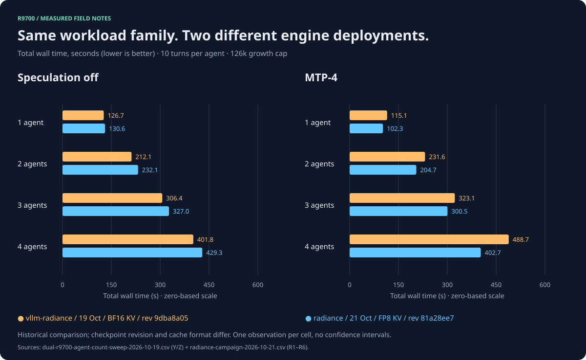

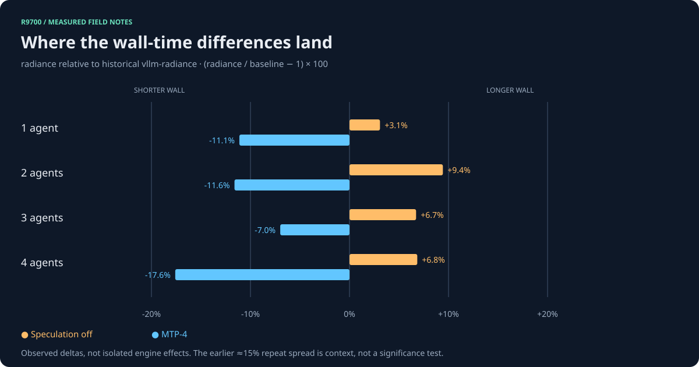

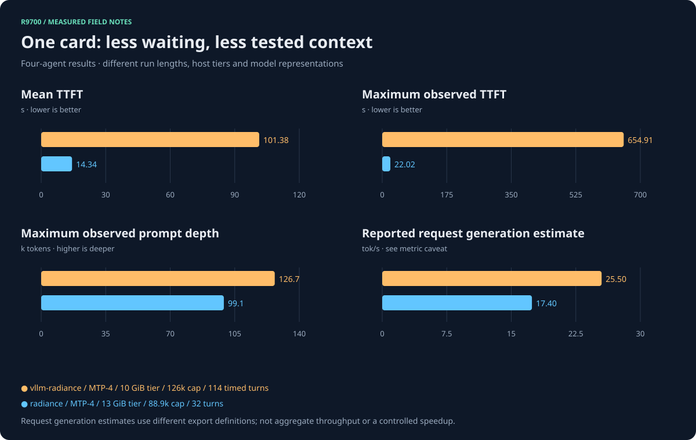

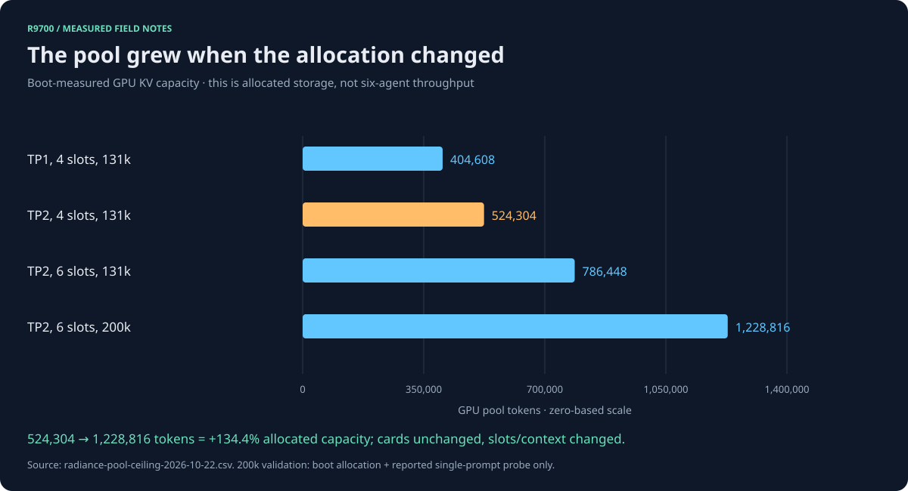

[Source hashes and limits](../graphs/rocm-10.1/editorial-chart-sources.json) · [Data definitions](DATA-DICTIONARY.md)

## Browse the archive

This gallery includes selected results only; exploratory graphs are available separately in the [unchosen archive](../graphs/rocm-7.14/unchosen.md); their per-turn CSVs remain omitted. See [what was excluded and why](EXCLUDED-TESTS.md). Charts use descriptive experiment names and separate ROCm folders. Version assignment follows recorded build/runtime evidence; unknown versions stay separate. Different workloads and settings are not a controlled ROCm comparison. Prompt-credit traces are diagnostic, not validated prefill throughput.

## ROCm 10.1

[Graph folder](../graphs/rocm-10.1/README.md) · [Data folder](../data/rocm-10.1/README.md)

### Dual R9700 model & spec-decode campaign — 19 October 2026

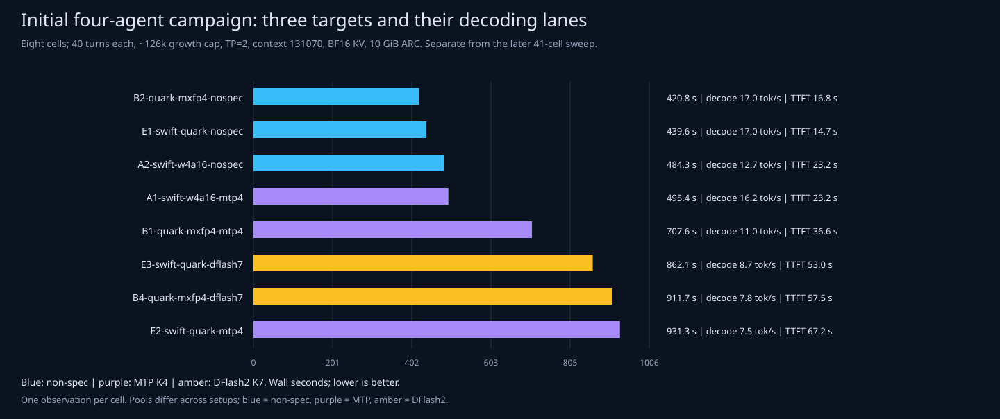

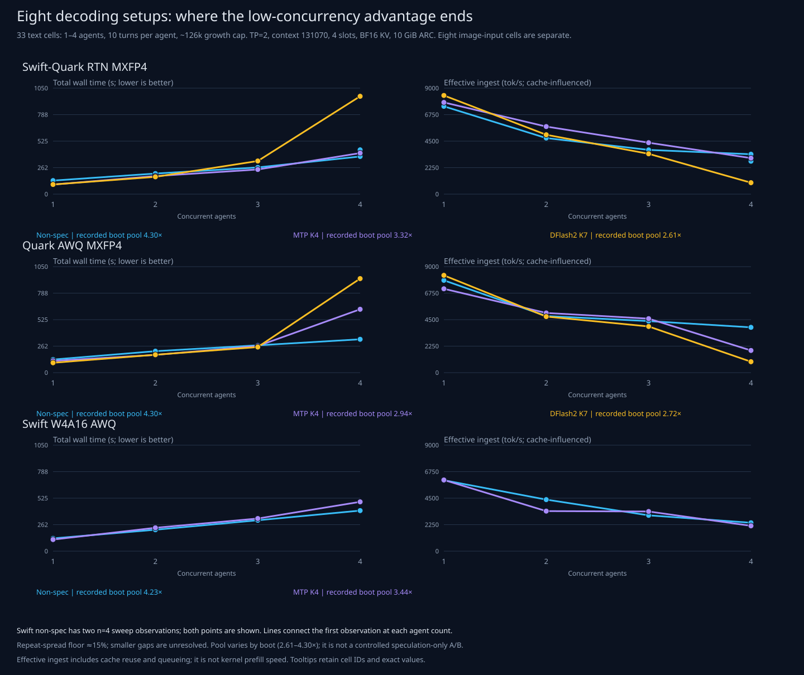

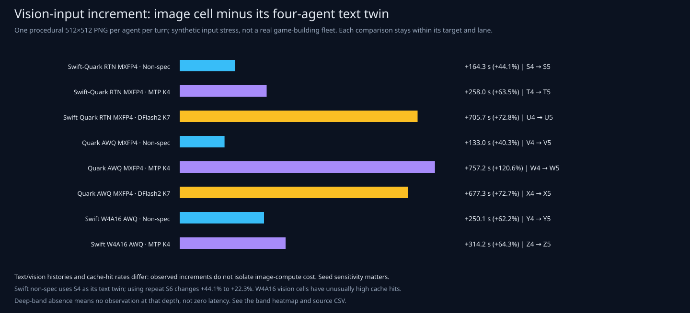

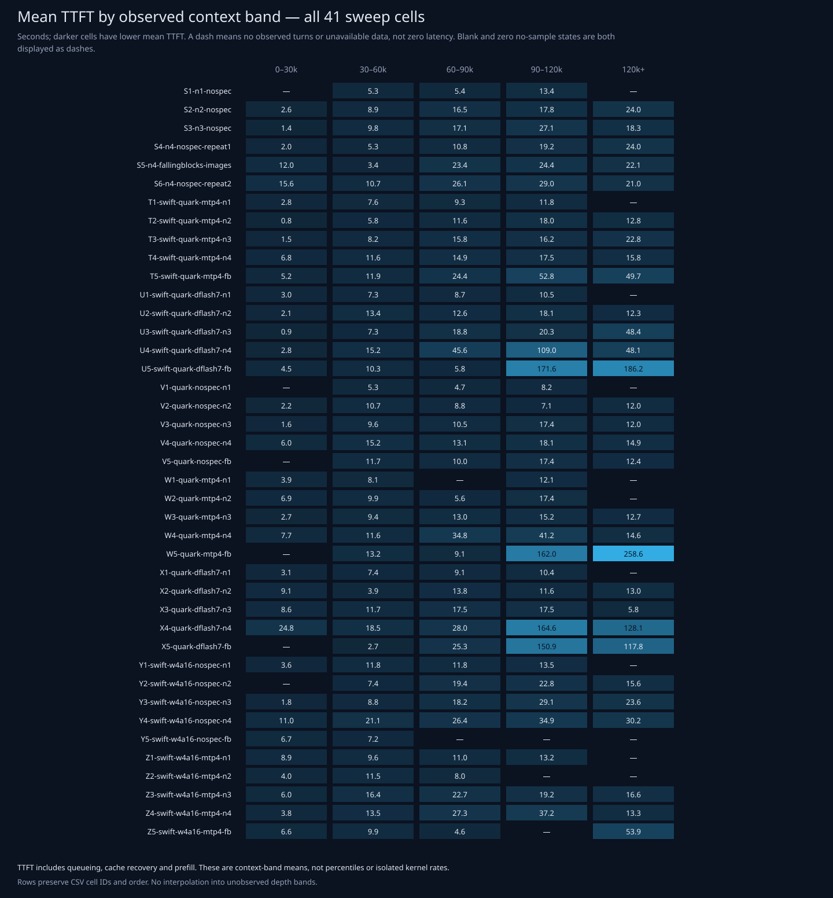

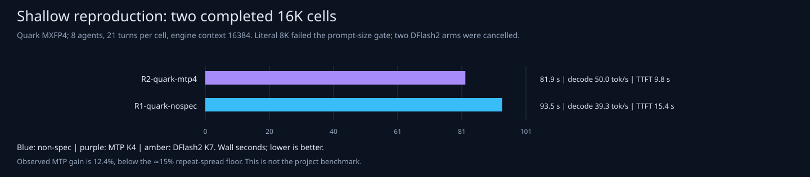

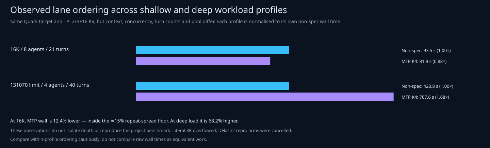

Eight setups, 41 sweep cells, 1,160 turns, zero client errors. The PNG-input cells are synthetic, separate from the game-building fleets. Recommendation: Swift-Quark non-spec at four agents; keep the ≈15% spread floor, boot-pool variation and vision seed sensitivity. Effective ingest is not kernel prefill. The shallow ordering is observational, with multiple settings changed. [Campaign write-up](DUAL-R9700-SPEC-CAMPAIGN.md) · [Campaign CSV](../data/rocm-10.1/dual-r9700-spec-campaign-2026-10-19.csv) · [Sweep CSV](../data/rocm-10.1/dual-r9700-agent-count-sweep-2026-10-19.csv) · [16K repro CSV](../data/rocm-10.1/dual-r9700-8k-repro-2026-10-19.csv).

ROCm base-image four-agent stress run

The 17 October journal explicitly identifies this stress workload as ROCm 10.1.

Sustained four-agent load on the newer runtime stack. Compare with older-stack data only as an indicative comparison because configuration and depth caps differ; this is a stress qualification.

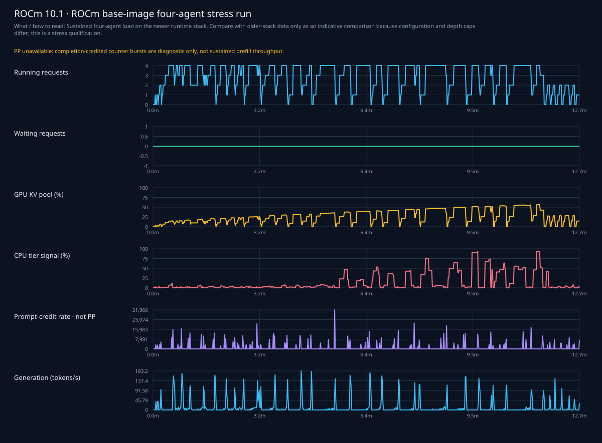

[Derived CSV](../data/rocm-10.1/rocm-base-image-four-agent-stress-run.csv)

Dual-engine wall time: different revisions and KV formats, 19–21 October 2026

Public 19 October Y/Z sweep and 21 October radiance 1.9.0 campaign exports; recovered harness, distinct target revisions and KV formats.

Observed wall times for vllm-radiance Y/Z references versus radiance R1–R6, n=1–4. Historical non-spec walls are shorter; radiance MTP-4 walls are shorter. Revisions differ (9dba8a05 vs 81a28ee7), as do BF16 vs FP8 KV. The old baseline was not rerun; no controlled engine effect or significance is established.

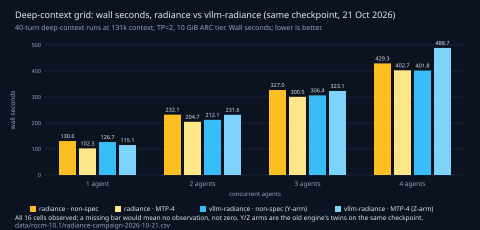

[Derived CSV](../data/rocm-10.1/radiance-campaign-2026-10-21.csv)

Single-card serving: per-turn price and TTFT, old engine vs radiance (22 October 2026)

18 October historical GPU A, 21 October radiance TP2 and 22 October radiance TP1 CSVs. Historical lane corrected to MTP-4 from its configuration JSON. Derived comparison rebuilt by tools/build_comparison_data.py.

Whole-cell wall per timed turn and mean TTFT across vllm-radiance GPU A MTP-4, radiance TP1 MTP-4 and radiance TP2 MTP-4. n4 TP1 growth cap is 88,913 versus historical 126,000; observed maximum prompts are 99,075 versus 126,691. Total turn counts and 10/13 GiB host tiers differ. Lower observed waits are not an equal-depth engine speedup.

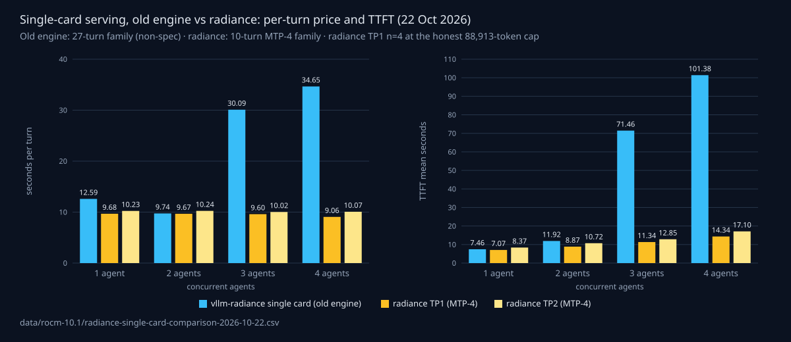

[Derived CSV](../data/rocm-10.1/radiance-single-card-comparison-2026-10-22.csv)

KV pool ceiling ladder: measured boots and marked projections (22 October 2026)

Recorded radiance 1.9.0 boot allocations, 21–22 October. Per-card density varies with allocation: 18.15 KiB/token at six-slot 131k, 17.74 at 200k. Dashed estimates remain unvalidated projections; a driver cap is not an available prefix-tier budget.

Four measured GPU boot allocations: TP1 404,608; TP2 four-slot 524,304; TP2 six-slot 131k 786,448; TP2 six-slot 200k 1,228,816 tokens. The original TP2 pool was slot-target limited; TP1 was VRAM limited. Host finished-conversation storage is separate from live GPU KV. Elastic and driver-cap rows are projections; allocation does not qualify concurrent full-depth performance.

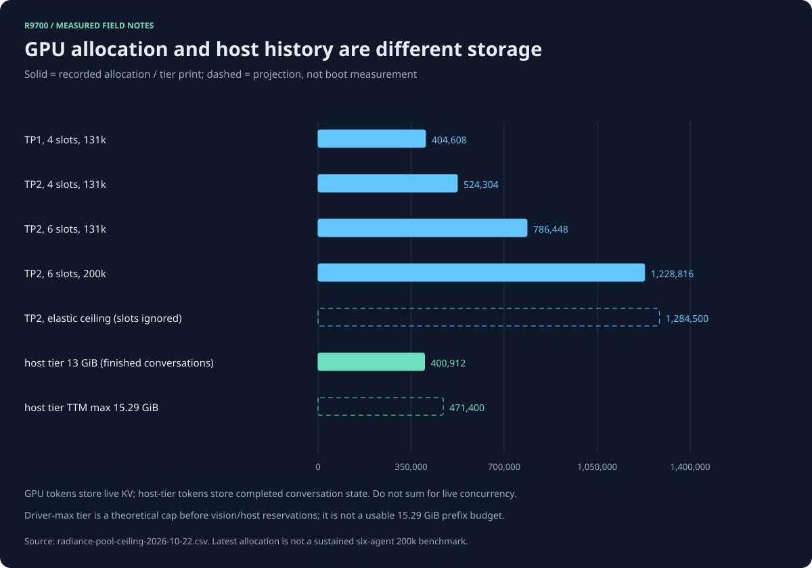

[Derived CSV](../data/rocm-10.1/radiance-pool-ceiling-2026-10-22.csv)

### Historical agent workloads

Exploratory cases within this recorded software profile; workloads and settings vary. These bars are not a controlled comparison.

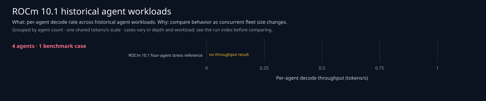

### Completed Falling Blocks fleets

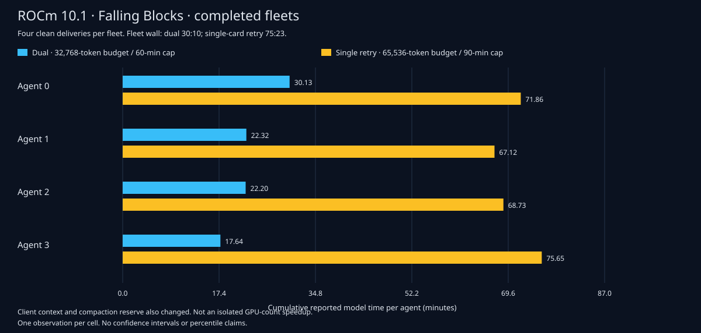

[Play all fifteen games](../examples/rocm-10.1/falling-blocks/index.html) · [Per-agent outcomes CSV](../data/rocm-10.1/falling-blocks-fleet-outcomes-2026-10-18.csv). Both final fleets delivered four games; budgets and client settings differed. The failed first single-card attempt remains in the report.

### Single-card GPU A context-growth report

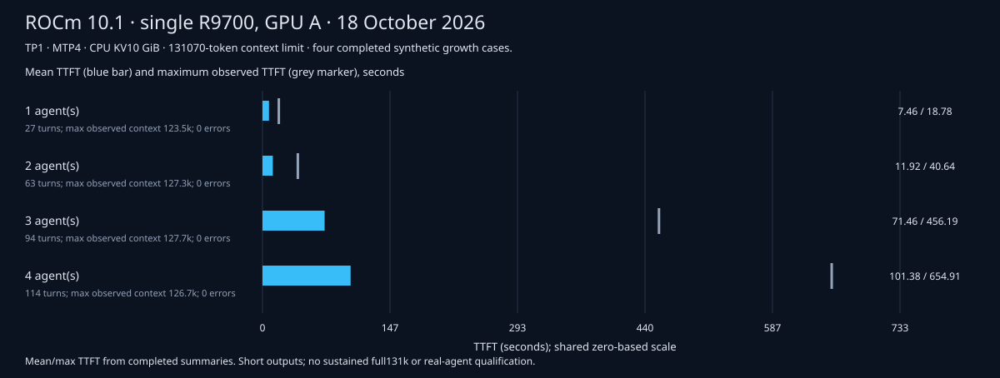

### Follow-up: single versus dual cards

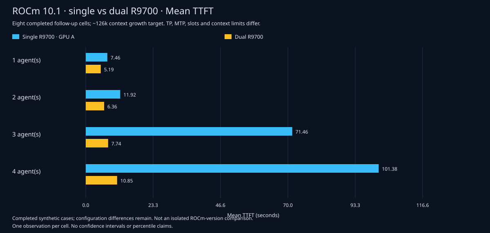

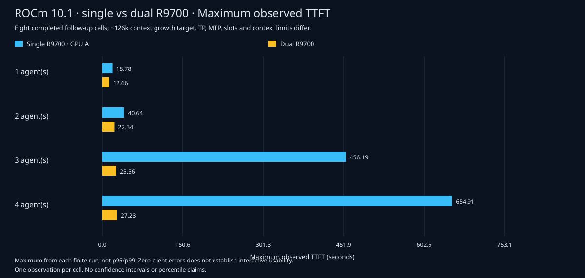

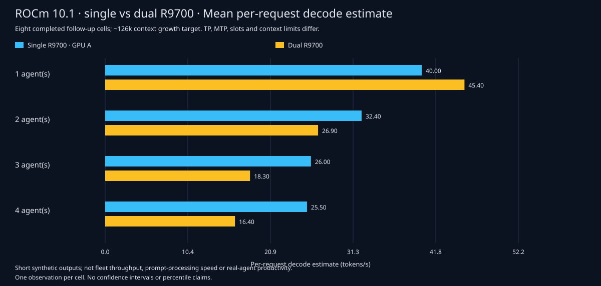

Short-output decode estimates are not fleet throughput or real-agent productivity. [Source data](../data/rocm-10.1/follow-up-single-vs-dual-text-growth-2026-10-18.csv).

### Historical single-card profile comparison

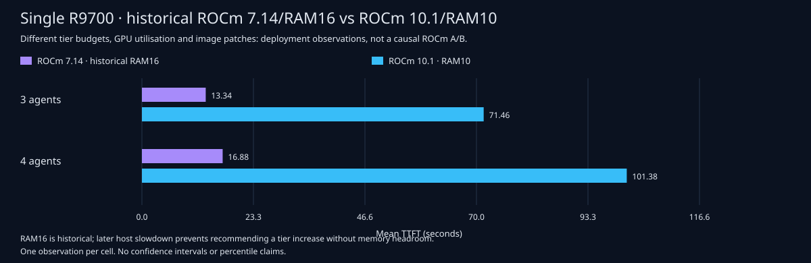

Different tier budgets, utilisation and image patches prevent an isolated ROCm-version conclusion.

### Dual-card text growth — 18 October 2026

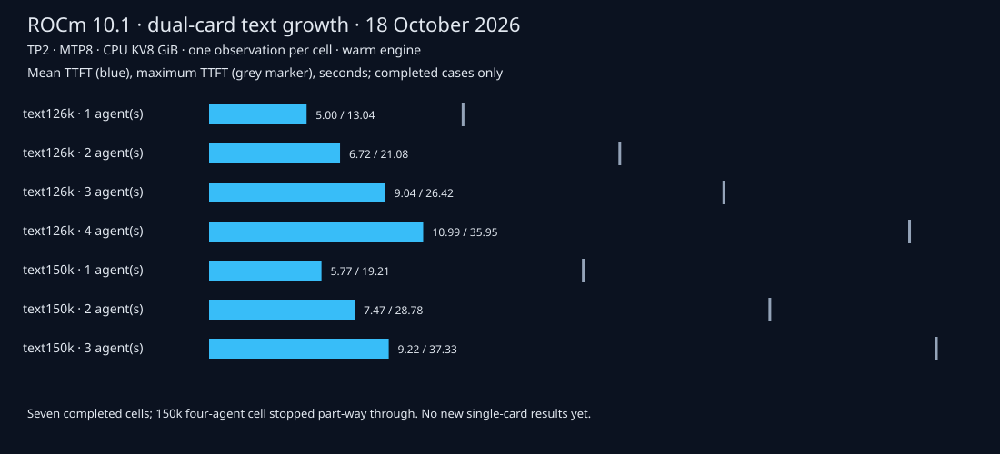

[Completed case measurements](../data/rocm-10.1/dual-card-text-growth-2026-10-18.csv)

See the [seven completed dual-card text cases](REPEAT-CAMPAIGN.md). Eight GPU A/dual follow-up cells have completed; see the [historical results](../HISTORICAL-OVERVIEW.md#latest-rocm-101-results) and [historical requirements and results](../HISTORICAL-OVERVIEW.md#best-recorded-single-card-setup-for-34-deep-context-agents) and [recorded configuration](../data/rocm-10.1/single-card-gpu-a-configuration.json). The [campaign report](FINAL-REPORT-20261018.md) records pressure telemetry and both first fleets; the single-card retry completed with all four agents delivering and exiting cleanly in 75:23.

## ROCm 7.14

[Graph folder](../graphs/rocm-7.14/README.md) · [Data folder](../data/rocm-7.14/README.md)

Single-card RAM16 tier, four agents at 131k target

ROCm 7.14 by recorded active profile and 6–8 October collection date; no immutable image ID captured per trace.

Qualification run for the 16 GiB shared-memory tier with four agents on one card. It is the key smooth-operation milestone; read error count, turn completion, TTFT by depth and memory pressure together.

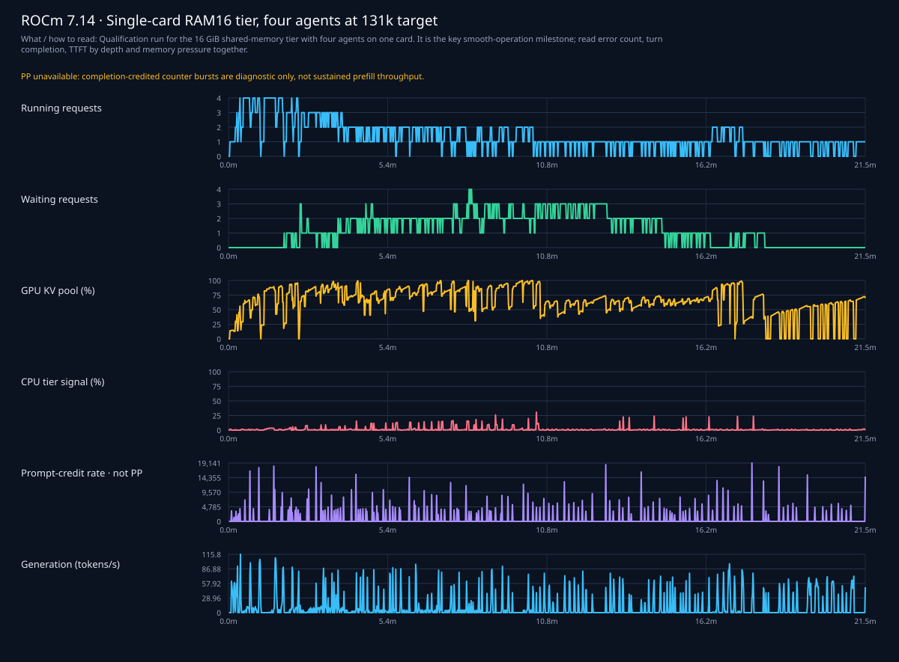

[Derived CSV](../data/rocm-7.14/single-card-ram16-tier-four-agents-at-131k-target.csv)

Single-card RAM16 tier, three agents at 150k target

ROCm 7.14 by recorded active profile and 6–8 October collection date; no immutable image ID captured per trace.

Follow-up capacity point with fewer agents and deeper context. Compare sustained completion and tail behaviour with the four-agent milestone.

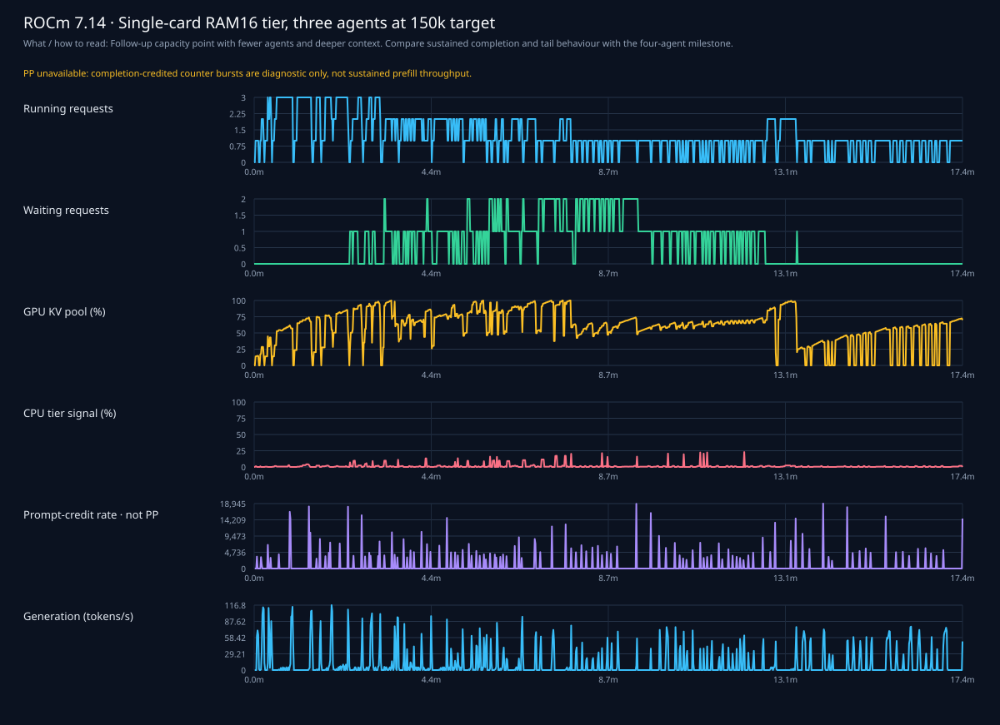

[Derived CSV](../data/rocm-7.14/single-card-ram16-tier-three-agents-at-150k-target.csv)

Host-memory trace for the RAM16 four-agent milestone

ROCm 7.14 by recorded active profile and 6–8 October collection date; no immutable image ID captured per trace.

Companion resource trace for the central four-agent single-card result. Check swap stays controlled while the shared-memory tier is active.

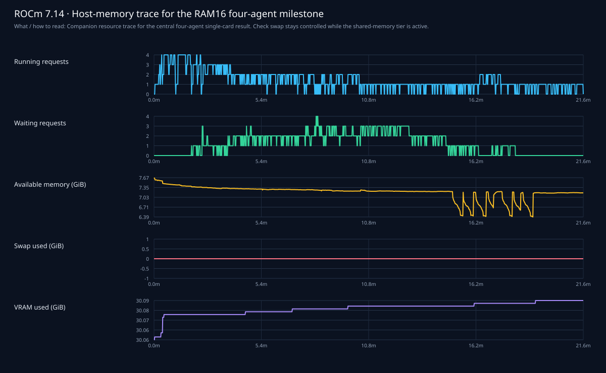

[Derived CSV](../data/rocm-7.14/host-memory-trace-for-the-ram16-four-agent-milestone.csv)

Host-memory trace for the RAM16 three-agent follow-up

ROCm 7.14 by recorded active profile and 6–8 October collection date; no immutable image ID captured per trace.

Resource companion for the deeper three-agent test. Compare memory headroom and swap with the four-agent tier run.

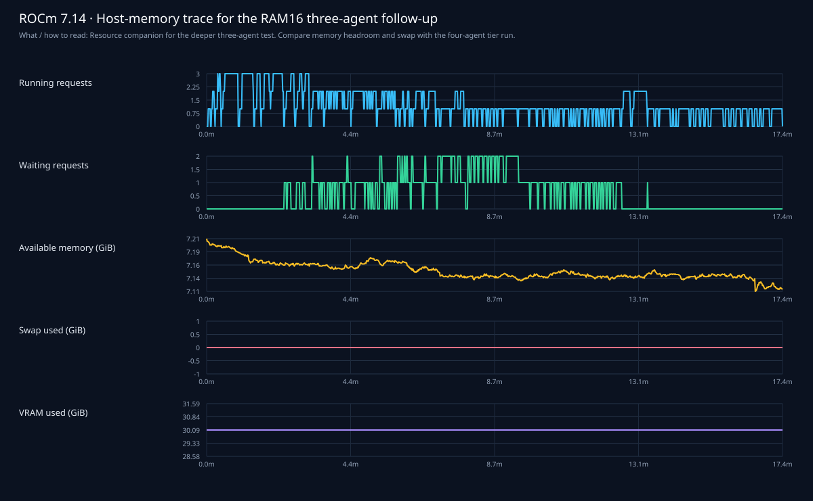

[Derived CSV](../data/rocm-7.14/host-memory-trace-for-the-ram16-three-agent-follow-up.csv)

### Historical agent workloads

Exploratory cases within this recorded software profile; workloads and settings vary. These bars are not a controlled comparison.

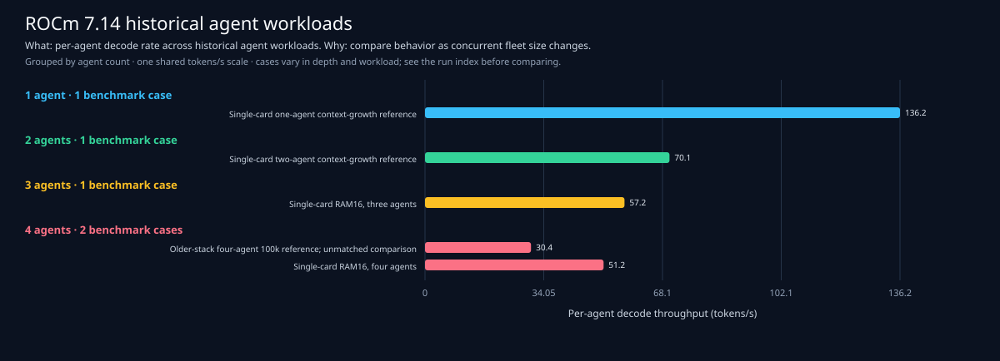

### Single-card historical context-growth report

The short one/two-agent references and the three/four-agent RAM16 milestones have different histories/settings.

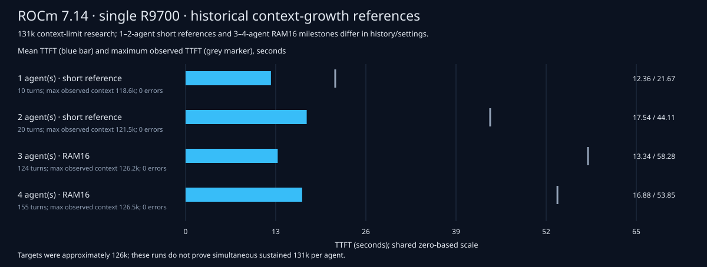

## Version unverified or mixed

[Graph folder](../graphs/version-unverified/README.md) · [Data folder](../data/version-unverified/README.md)

<!-- NAVIGATION START -->

[Home](../index.md) · [Compare](RADIANCE-VS-VLLM.md) · [vllm-radiance](VLLM-RADIANCE.md) · [radiance](RADIANCE.md) · [Stuff for nerds](CODE-CORNER.md) · [Disclosure](REPRODUCIBILITY.md)
<!-- NAVIGATION END -->
